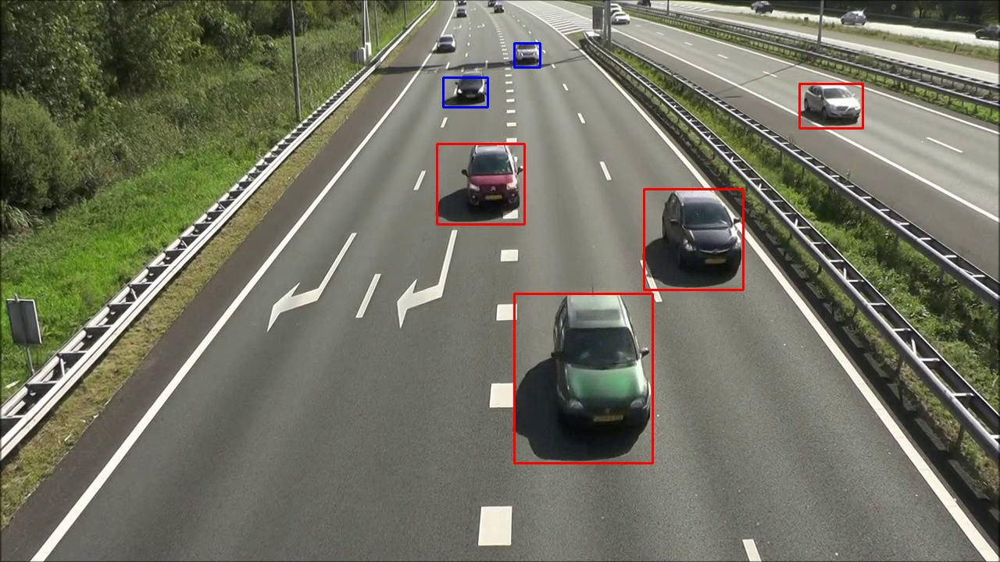
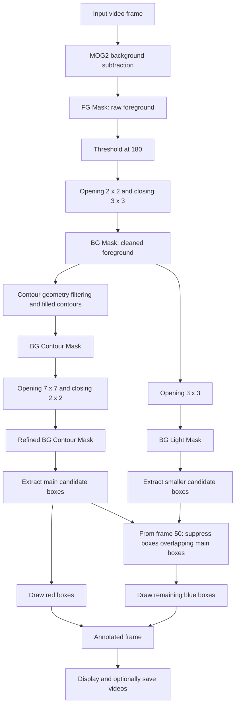
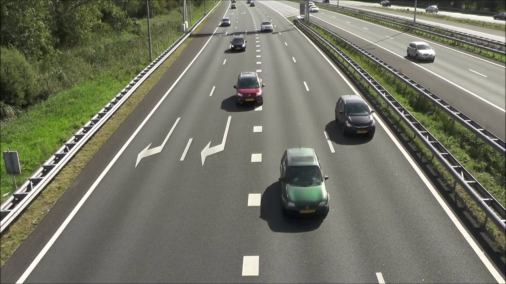
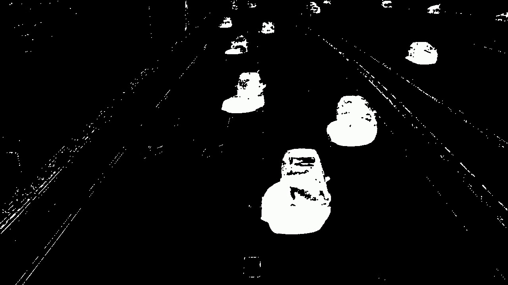
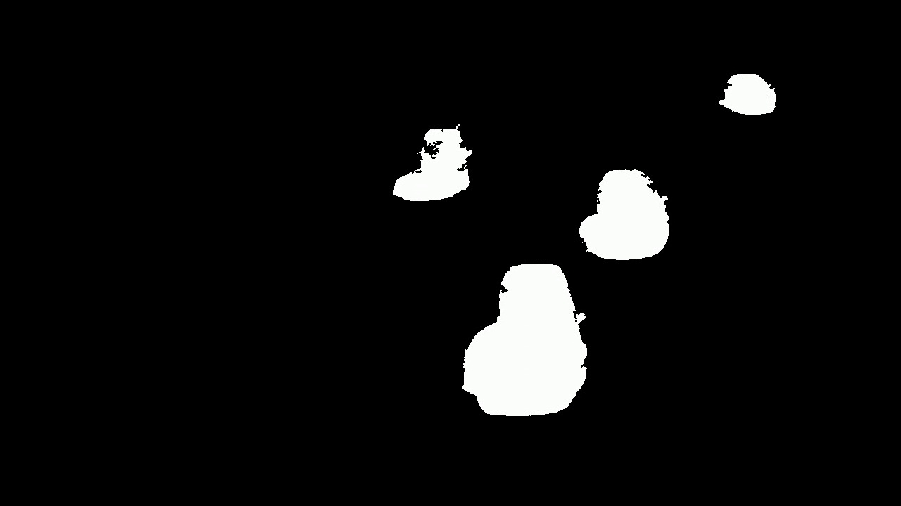
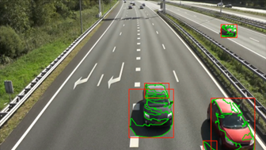

# OpenCV Highway Motion Detection

A traditional computer vision project for detecting moving vehicles in fixed-camera highway video. The final pipeline combines **MOG2 background subtraction**, **morphological filtering**, and **contour geometry** to draw vehicle candidate boxes while reducing foreground noise and thin railing-like connections.

The project compares three approaches and selects a MOG2-based pipeline with two post-processing branches: a refined branch for cleaner main detections and a lighter branch to recover some smaller vehicles. It runs locally and requires no model weights, training dataset, GPU, or cloud service.



**Red boxes:** detections from the refined branch. **Blue boxes:** additional detections from the lighter branch. The colors identify processing branches, not vehicle classes or confidence scores.

## Contents

- [Project goal and implemented work](#project-goal-and-implemented-work)
- [Architecture](#architecture)
- [Why this design](#why-this-design)
- [Visual walkthrough](#visual-walkthrough)
- [Method comparison and evaluation](#method-comparison-and-evaluation)
- [Project files](#project-files)
- [Installation and usage](#installation-and-usage)
- [Parameters and tuning](#parameters-and-tuning)
- [Limitations](#limitations)
- [Validation](#validation)
- [License and media](#license-and-media)

## Project goal and implemented work

The goal is to separate moving road traffic from a largely static scene and produce useful bounding boxes using interpretable image-processing operations. The main challenges are fragmented foreground regions, noise from road and roadside structures, thin connections between regions, and small vehicles far from the camera.

Work implemented in this project includes:

- A pure frame-differencing baseline and a MOG2/frame-difference intersection baseline.
- A final MOG2 pipeline with thresholding, opening/closing, contour filtering, and additional morphological refinement.
- A second, less aggressive branch with smaller contour thresholds to preserve some vehicles removed by the main branch.
- Background-model warm-up, delayed auxiliary detections, and overlap-based suppression of redundant auxiliary boxes.
- A controlled synthetic motion test, qualitative evaluation on highway footage, and saved intermediate masks for diagnosing failures.
- A screenshot utility for reviewing saved videos.

The detector identifies **moving regions with vehicle-like geometry**. It does not assign semantic vehicle classes, track identities, count traffic, or estimate speed.

## Architecture

The application is a collection of standalone Python scripts with command-line input/output configuration. The final detector performs the following operations sequentially for each video frame:



All morphology kernels are elliptical. The branches share **one MOG2 foreground estimate**; the auxiliary branch is a different post-processing path, not another background model.

### Processing stages

| Stage | Operation | Purpose |
| --- | --- | --- |
| Background modeling | MOG2 with `history=500`, `varThreshold=25`, `detectShadows=False`; explicit `learningRate=0.02` | Estimate foreground relative to an adapting background |
| Initial cleanup | Binary threshold, then opening and closing | Remove isolated pixels and improve region continuity |
| Main candidate mask | External contours filtered by area, size, aspect ratio, and extent; accepted contours are filled | Retain plausible vehicle regions |
| Main refinement | Stronger opening followed by a small closing | Suppress thin railing-like connections; boxes are extracted and filtered again afterward |
| Auxiliary mask | Lighter opening applied directly to the cleaned mask, followed by relaxed contour filtering | Recover some small candidates lost by stronger refinement |
| Box selection | Keep main boxes and suppress auxiliary boxes with substantial overlap with a main box | Reduce redundant boxes between branches |
| Visualization | Optional display windows and MP4 outputs | Inspect each stage and the final detections |

**Mask naming:** although the code uses names such as `BG Mask`, these images contain foreground candidates. They are not reconstructed background images.

**Startup:** frames 1-20 update the background model and display/save unannotated input frames. Main detections begin at frame 21; auxiliary blue boxes may appear from frame 50 onward. These are frame counts, not durations in seconds.

**Overlap rule:** an auxiliary box is suppressed if its intersection area divided by the smaller box area is **greater than 0.3** for any main box. This is not intersection-over-union (IoU), and it does not merge boxes or provide tracking across frames.

## Why this design

- **MOG2 fits the fixed-camera setting.** A background model can adapt to the scene while highlighting vehicles moving through it. This provides a local, training-free starting point.
- **Post-processing matters as much as foreground extraction.** Raw MOG2 masks still contain noise and connected structures. Morphology and geometric filters make those masks more useful for box extraction.
- **One cleanup strength is a compromise.** Strong opening can remove narrow artifacts but also erase small vehicles. The lighter branch starts before main-branch contour filtering, giving smaller candidates a separate path to the output.
- **Combining methods can discard useful pixels.** Intersecting MOG2 with adjacent-frame differences can leave only changing parts of a vehicle, fragmenting its silhouette. The final method therefore uses MOG2 alone for foreground estimation.
- **Intermediate masks make tuning explainable.** Inspecting the first stage where a target disappears helps identify whether background estimation, cleanup, contour rules, or refinement caused the miss.

## Visual walkthrough

The following archived images show the highway scene and the final pipeline's intermediate outputs.

| Original frame | Raw MOG2 foreground |
| --- | --- |
|  |  |

| Cleaned foreground (`BG Mask`) | Filtered contour mask |
| --- | --- |
|  |  |

| Refined main-branch mask | Lighter auxiliary mask |
| --- | --- |
|  |  |

The lighter branch can preserve smaller regions that stronger refinement removes. It can also admit additional noise; the two branches use different filtering strengths to balance these effects.

## Method comparison and evaluation

### Controlled synthetic test

The synthetic video was created in PowerPoint: a blue rectangle moves over a white background while a black object remains stationary. This provides a simple check that the pipeline responds to motion rather than merely to object presence.


The project report records successful separation of the moving object from the stationary object and generation of a bounding box. The image above is an **input frame**, not an annotated detection result.

### Highway video

| Approach | Implementation in this folder | Qualitative observations from the project experiments |
| --- | --- | --- |
| Pure frame differencing | `frame_difference.py`: grayscale, blur, adjacent-frame absolute difference, thresholding, morphology, and contour filters | Detected motion, but often produced fragmented regions and incomplete vehicle boxes |
| MOG2 + frame differencing | `mog2_frame_difference.py`: pixel-level intersection of the two cleaned masks | Removed some noise, but could fragment vehicles into regions too small to pass contour filters |
| Final MOG2 pipeline | `motion_detection.py`: MOG2 with refined and light post-processing branches | Selected for the best observed balance between noise suppression and vehicle completeness in the tested footage |

| Frame-differencing example | MOG2 + frame-difference example |
| --- | --- |
|  |  |

These are archived examples, not a synchronized frame-by-frame benchmark. The final pipeline's result is shown at the top of this README.

The report also discusses an experiment with box-level intersection, but a separate implementation of that variant is not present among the current Python scripts. The supplied fusion baseline implements **pixel-level intersection**.

Evaluation used one synthetic clip and one real highway clip. Conclusions are qualitative: this folder does not contain labeled ground truth, precision/recall or mAP measurements, or a measured processing-speed benchmark. Results on these clips do not establish performance across other cameras, resolutions, lighting conditions, or traffic scenes.

## Project files

```text
.
├── motion_detection.py           # Final MOG2 pipeline
├── frame_difference.py           # Pure frame-differencing baseline
├── mog2_frame_difference.py       # Pixel-level intersection baseline
├── extract_frames.py             # Representative-frame extraction utility
├── examples/generate_demo.py     # Original reproducible synthetic demo
├── tests/test_cli.py             # Command and output checks
├── docs/images/                  # Archived experimental screenshots
├── requirements.txt
├── .gitignore
└── LICENSE
```

Each detector is a standalone script. The frame extractor and demo generator are separate utilities. Input clips and full result videos are not bundled; the demo generator makes a local input video without any downloads.

## Installation and usage

### 1. Install

Python **3.12** is the tested environment. Clone the repository, create a virtual environment, and install the pinned dependencies:

```bash
git clone https://github.com/MohanZ0618/opencv-highway-motion-detection.git
cd opencv-highway-motion-detection
python -m venv .venv
```

Activate the environment on Windows PowerShell:

```powershell
.\.venv\Scripts\Activate.ps1
```

Or on macOS/Linux:

```bash
source .venv/bin/activate
```

Then install:

```bash
python -m pip install -r requirements.txt
```

For windowed use, OpenCV requires desktop GUI support. Use `--no-display` when running without a desktop session. The provided dependency is `opencv-python`, not its headless-only variant.

### 2. Try the generated demo

```bash
python examples/generate_demo.py --output data/demo.mp4
python motion_detection.py data/demo.mp4 --output-dir outputs/demo
```

The generator creates an original 120-frame video with a moving blue rectangle and a stationary black circle. This is a reproducible software demo added for this repository; it is separate from the original PowerPoint clip used in the project experiments.

Six OpenCV windows display the intermediate masks and final detections. Give an OpenCV window focus and press **Esc** to stop, or let the video finish. The blue rectangle can receive red or blue boxes because box colors indicate processing branches, not the shape's own color.

### 3. Process your own video

```bash
python motion_detection.py "path/to/traffic.mp4" --output-dir outputs/highway
```

For processing without GUI windows:

```bash
python motion_detection.py "path/to/traffic.mp4" --output-dir outputs/highway --no-display
```

The scripts create the output directory. Use a different output folder per run to preserve previous results.

| Option | Meaning |
| --- | --- |
| `video` | Required path to an input video |
| `--output-dir PATH` | Output folder; defaults to `outputs` |
| `--no-save` | Disable video export |
| `--no-display` | Disable GUI windows and process until the input ends |
| `--help` | Show command usage |

The options above are shared by all three detector scripts. When both `--no-save` and `--no-display` are used, processing completes without visible or saved output.

### 4. Inspect the exported videos

| Filename | Contents |
| --- | --- |
| `output_final.mp4` | Frames annotated with red/blue boxes |
| `output_fg_mask.mp4` | Raw MOG2 foreground |
| `output_bg_mask.mp4` | Thresholded and cleaned foreground |
| `output_bg_contour_mask.mp4` | Geometrically filtered, filled contours |
| `output_refined_bg_contour_mask.mp4` | Refined main-branch mask |
| `output_bg_light_mask.mp4` | Auxiliary-branch mask |

Video export uses the `mp4v` codec and the input video's reported FPS. The main detector falls back to 20 FPS if the reported value is nonpositive. This FPS is playback metadata, not a processing-speed measurement. An output initialization error reports a problem with the folder or codec instead of silently proceeding.

### 5. Compare the baselines

```bash
python frame_difference.py "path/to/traffic.mp4" --output-dir outputs/frame-difference
python mog2_frame_difference.py "path/to/traffic.mp4" --output-dir outputs/intersection
```

Add `--no-display` for either command to run without windows. Use the same input clip and compare foreground completeness, fragmentation, small-object misses, and spurious detections.

The frame-difference baseline saves `pure_frame_differencing_output.mp4`; the intersection baseline saves `mog2_plus_frame_difference_output.mp4`. The intersection baseline omits its first input frame and skips writing its 20 warm-up loop iterations, preserving the original experiment's behavior. Its export therefore is not directly timestamp-aligned with the main detector's output.

### 6. Extract a representative screenshot

```bash
python extract_frames.py outputs/highway --output-dir screenshots/highway --position 0.7
```

The utility scans only the selected folder, not its subdirectories, and accepts `.mp4`, `.avi`, `.mov`, and `.mkv` filenames. It saves one JPEG per video. `--position` is a fraction from 0 to 1; use `0.5` for the midpoint. The default `0.7` preserves the original utility's sampling position.

## Parameters and tuning

The following are the final detector's current defaults. Length thresholds are in pixels and contour areas are in square pixels, so changing resolution or camera perspective can require retuning.

| Parameter | Main branch | Auxiliary branch |
| --- | --- | --- |
| Minimum contour area | `> 1100` | `> 500` |
| Minimum box width and height | Both `> 30` | Both `> 18` |
| Aspect ratio (`width / height`) | `0.6 < ratio < 3.5` | Same |
| Minimum extent (`contour area / box area`) | `> 0.2` | `> 0.12` |
| Branch-specific morphology | Opening `7 x 7`, then closing `2 x 2`, after contour filtering | Opening `3 x 3` on the cleaned foreground |
| First eligible detection frame | 21 | 50 |

Both branches use the shared MOG2 and initial cleanup settings described above. Smaller thresholds may admit more vehicles and more noise. Stronger opening may suppress thin artifacts while removing distant targets. `detectShadows=False` disables MOG2's shadow-labeling feature; it does not mean physical shadows have been removed.

For a missed vehicle, inspect the stages in order:

| First stage where the vehicle disappears | What to inspect |
| --- | --- |
| Raw FG Mask | Background-model adaptation, foreground contrast, scene motion, and MOG2 settings |
| Cleaned BG Mask | Thresholding and initial morphology |
| BG Contour Mask | Area, dimensions, aspect ratio, and extent constraints |
| Refined mask | Whether the strong opening erases or splits the target |
| Final boxes | Reapplied contour rules, warm-up/delay, and auxiliary overlap suppression |

## Limitations

- Assumes a fixed camera and a reasonably stable background. Camera motion and strong scene changes can create widespread foreground responses.
- Detects motion rather than semantic object identity. Other moving objects can pass the geometry filters, and stopped vehicles can become part of the background.
- Distant or low-contrast vehicles may flicker between detected and undetected states. Shadows can enlarge or distort foreground regions.
- Hand-tuned pixel thresholds are scene- and resolution-dependent. Closely spaced vehicles can merge into one region; a single vehicle can still fragment.
- Boxes are selected independently per frame. There is no temporal tracker, persistent ID, confidence score, counting line, or speed estimator.
- Thresholds remain configured in source. The CLI controls video paths and display/export behavior; it does not perform automatic scene calibration. There is no labeled accuracy benchmark.

Potential extensions include labeled multi-scene evaluation, resolution-aware filtering, explicit shadow handling, and temporal tracking. These are future improvements rather than current features.

## Validation

Run the automated checks after installing the dependencies:

```bash
python -m unittest discover -s tests -v
```

The checks generate a synthetic video, run all three detector commands without GUI windows, read every main-pipeline export, verify frame counts and dimensions, check warm-up and the presence of main-branch detections, exercise screenshot extraction, and test invalid inputs.

The release was checked with Python 3.12, NumPy 2.3.5, and OpenCV 5.0.0 (package `opencv-python==5.0.0.93`). On the original highway clip, the release and original scripts also produced identical intermediate masks and annotated frames in a frame-by-frame comparison (335 main-pipeline frames; 334 loop frames for each baseline). These are software integration checks, separate from the original project's qualitative highway-video evaluation. They do not measure vehicle-detection accuracy or establish real-time performance.

## License and media

Source code is provided under the [MIT License](LICENSE). The license does not grant rights to underlying third-party highway footage or derived screenshots. See the [media provenance note](docs/images/README.md). Full highway input/output videos and original coursework documents are not distributed in this repository.
